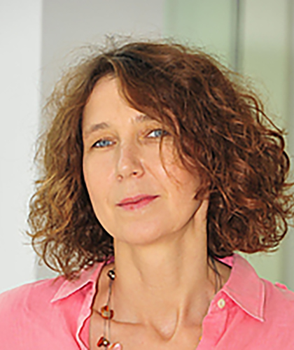

# Keynotes

<!-- Keynote 2 -->
<a href="https://robotics.umd.edu/clark/faculty/1168/Cornelia-Fermuller" target="_blank" rel="noopener noreferrer">01
<h3>Cornelia Fermüller</h3>

Cornelia Fermüller is a research scientist in the <strong>UMIACS Computer Vision Laboratory.</strong>

Fermüller’s research is in the areas of computer vision and human vision, and she has written more than 35 articles in journals and 100 publications in refereed conferences and books. In her computer vision work, she has developed many computational models and implemented software solutions for applications in visual navigation and image processing. Fermüller's work on biological vision involves examining the computational constraints, building simulation models, and performing psychophysical experiments to understand the possible computational mechanisms explaining human motion and low-level signal perception.
<b>See More →</b>
</a>

<!-- Keynote 2 -->
<a href="{{ '/schedule/' | relative_url }}">02
<h3>Keynote #2</h3> 

TBD!
<b>See More →</b>
</a>

