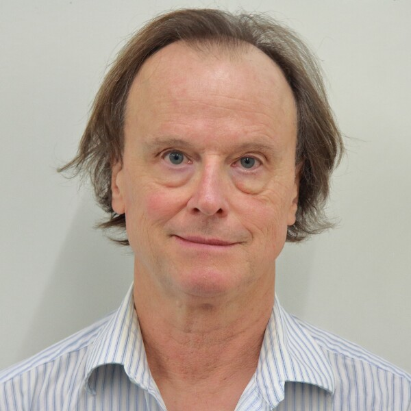
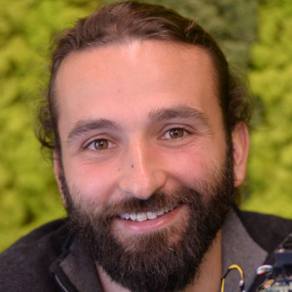
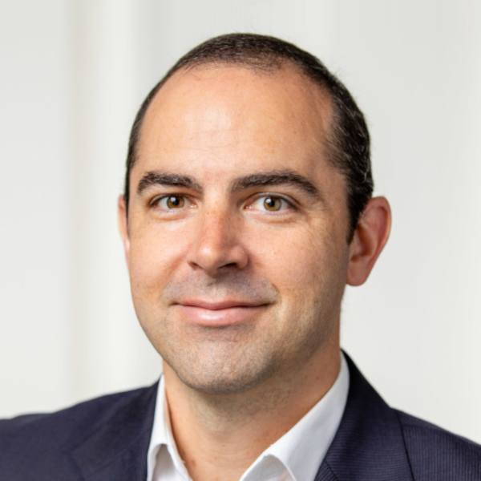
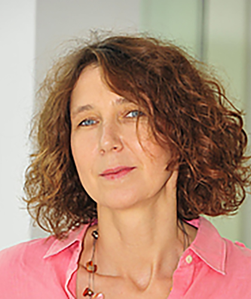
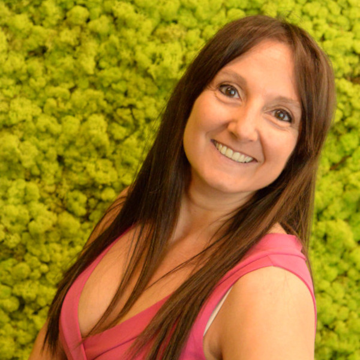

# Schedule: Event Vision School 2026

> TODO: add group project (when announce, how?), add guest lecturers

<table class="day-links">
  <thead>
    <tr>
      <th><a href="#monday-18th">Day 1</a></th>
      <th><a href="#tuesday-19th">Day 2</a></th>
      <th><a href="#wednesday-20th">Day 3</a></th>
      <th><a href="#thursday-21st">Day 4</a></th>
      <th><a href="#friday-22nd">Day 5</a></th>
    </tr>
  </thead>
</table>

> Start: **9am** Sharp!  
> Coffee Breaks: Every day at **11am and 4pm!**  
> Lunch: Every day at **1pm**  
> Mandatory Sports Breaks: Every day at **6pm**

Sunday 16th
--

15:00 - Check-in Open

> TODO: add check in instructions for hotel

18:00 – 20:00 Welcome Apero - Ice breaker game

All participants are warmly invited to join the welcome aperitivo, where they will be welcomed by the organisers and have the opportunity to meet the other attendees through an ice-breaker activity.

Monday 17th
--
9:00 - 10:00 School introduction and student 1 min introduction presentations

10:00 – 13:00 Lectures on fundamentals of Event-Driven Vision

    T. Delbruck – History and basics of event-cameras, limitations, noise, models

    C. Bartolozzi - Event Cameras, Spikes and Information

    A. Glover - Processing Techniques and Event Representation​s
    

14:00 – 18:00 Assignments :

    M. Iacono - How to read events, avilable tools, visualisation, and basics for the EVS

  -  Representing and visualising events
  -  Connecting the live camera

||||
|:---:|:---:|:---:|
| **Tobi Delbruck** | **Massimiliano Iacono** | **Arren Glover** |
| [@tobidelbruck](https://github.com/tobidelbruck) | [@iaxama](https://github.com/iaxama) | [@arrenglover](https://github.com/arrenglover) |

    
Tuesday 18th
--

9:00 – 13:00 Lectures on algorithmic approaches in Event-Driven Vision

    G. Gallego - Contrast maximization, Optical Flow, and SLAM with Event Cameras

    A. Glover - Pertubation Tracking: corners, lines, and objects

    ? - ?
    

14:00 – 18:00 Assignments :
  - Perturbation Tracking
  - Contrast Maximisation

|| |
|:---:|:---:|
| **Guillermo Gallego** | **Arren Glover** |
| [@guillermogb](https://github.com/guillermogb) | [@arrenglover](https://github.com/arrenglover) |

21:30 – 22:30 Keynote, Cornelia Fermüller

||
|:---:|
| **Cornelia Fermüller** |
| [@fermuller](https://github.com/fermuller) |

Wednesday 19th
--

9:00 – 13:00 Lectures on AI-based approaches for Event-Driven Vision

    G. Goyal – Input Represenations, Overview of Different Networks, Application - Observing Humans (pose estimation, action recognition, eye tracking), graph neural networks

    M. Iacono – Architectures and training SNNs for vision (CNN, RNN, LSTM, surrogate-gradient, bptt, eligibility traces, eProp, etc.)

    ? - ?
    

14:00 – 18:00 Assignments :
  - Convolutional NN for event-driven recognition
  - Recursive NN for temporal integration during recognition
  - Spiking NN - how to design the surragate gradient

|||
|:---:|:---:|
| **Gaurvi Goyal** | **Massimiliano Iacono** |
| [@gaurvigoyal](https://github.com/gaurvigoyal) |  [@iaxama](https://github.com/iaxama) |

19:00 – 22:30 Social Dinner

Thursday 20nd
--

9:00 – 13:00 Lectures on event-based vision for robot control

    J. Conradt – closed loop robotics with event-driven vision and neuromorphic hardware

    A. Glover - low-latency vision and asynchronous reinforcement learning for real-time interaction in high-speed tasks

    Y. Sandamirskaya - ?

14:00 – 18:00 Assignments :
  - [Visual Servoing](https://github.com/event-driven-vision-school/genx320-handson/pkgs/container/genx320-handson)

||  |  
|:---:|:---:|
| **Jorg Conradt** | **Arren Glover** |
| [@jconradt](https://github.com/jconradt) | [@arrenglover](https://github.com/arrenglover) |

21:30 – 22:30 Keynote, TBD

Friday 21st
--

9:00 – 11:00 Short Lectures on Beyond Vision

    C. Bartolozzi – Beyond Vision with Events
    
|  |
|:---:|
| **Chiara Bartolozzi** | 
| [@ChiaraBartolozzi](https://github.com/ChiaraBartolozzi) |

11:00 - 4:00pm Group work

4:00pm - 6:00pm Group Presentations

Saturday 23rd
--

Goodbye and departures
